# HitPriority

App to prioritise hits from FRET and FP screens.

## Software requirements

R 4.3.1 or later.

## How to run

1. Install the packages: `Rscript install_dependencies.R`
2. Open `app.R` in RStudio and click **Run App**, or run `shiny::runApp(".")`.

## Project layout

The project is kept flat (no sub-folders). Files are grouped by prefix:

| Group | Files |
|---|---|
| Entry point | `app.R`, `install_dependencies.R` |
| Interface | `ui.R`, `visuals_tab.R` |
| Server logic | `server.R`, `core.R`, `results.R`, `qc.R`, `session.R`, `visuals.R` |
| Helpers | `calc_distances.R`, `process_csv_matrices.R`, `DT_format_sci.R`, `calc_norm_rmsd.R`, `plot_plate.R`, `system_helpers.R`, `hit_helpers.R`, `qc_helpers.R`, `k_suggest.R`, `excel_report.R`, `viz_helpers.R` |
| Tests | `test-helpers.R`, `test-visuals.R` |
| Example data and maps | `1114695724.csv`, `Premapped_Example.csv`, `HTS_1536_primary.csv`, `HTS_384_primary.csv`, `384_HTS_CR.csv`, `1536_10pt_sing_2013_HTS.csv` |
| Reports and guides | `report.Rmd`, `report_style.docx`, `report_test.docx`, `HitPriorityGuide.docx` |
| HTML help pages | `PlateMaps.html`, `document.html`, `normalisation.html`, `normalisation_old.html`, `premapped.html` |

GitHub Actions needs `.github/workflows/R-tests.yml`, so that one hidden folder must remain.

## Diagrams

### 1. How the app is built

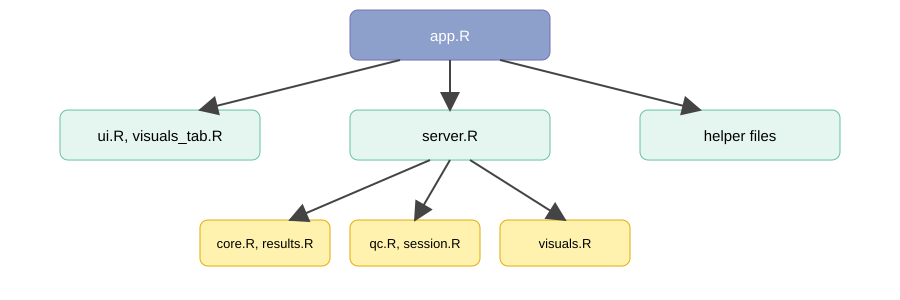


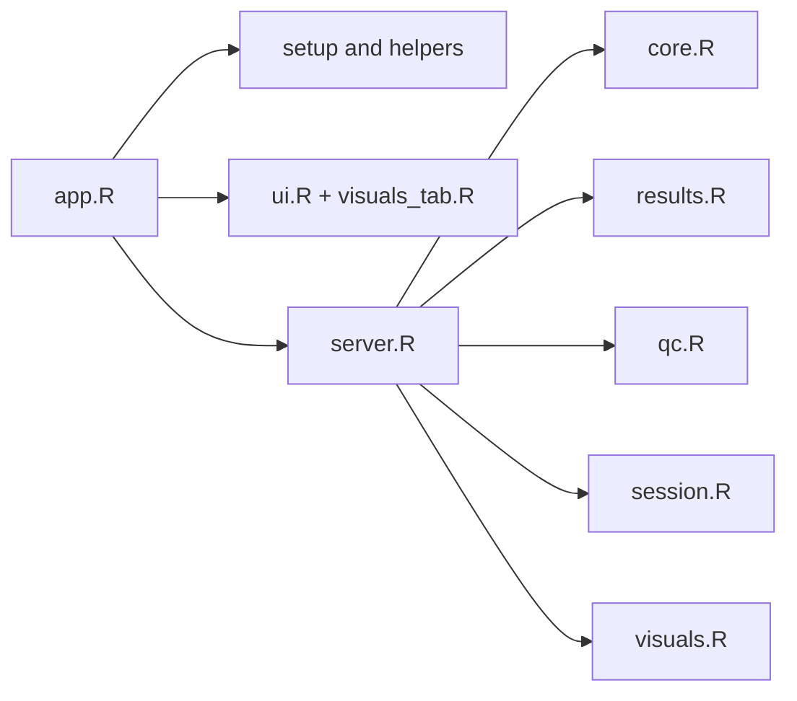

### 2. Analysis pipeline

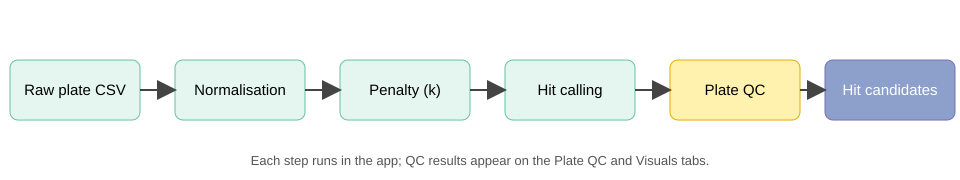


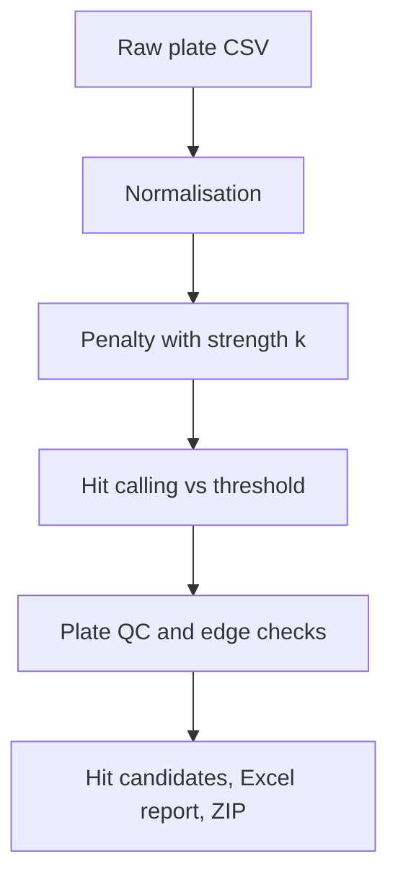

### 3. Hit classes

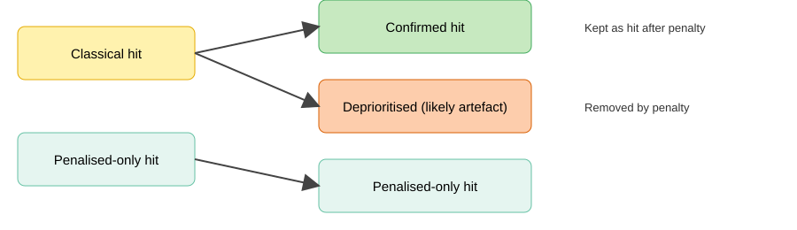


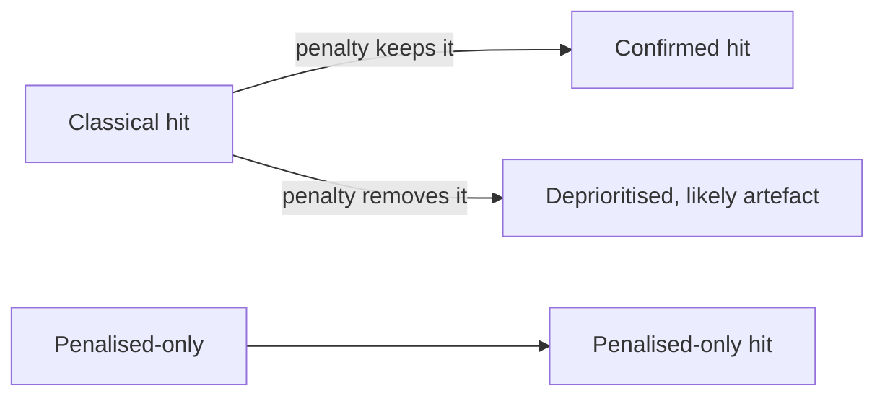

### 4. Plate QC, ASCII view

```
Plate  Z'    Edge    Status
  01   0.72  OK      Pass
  02   0.31  Review  Z' low
  03   0.65  Review  Edge effect
```

### 5. Comparison of methods

| Measure | Without penalty | With penalty |
|---|---|---|
| Hit calling | Raw value vs threshold | Value plus k times distance from centre |
| Artefact handling | None | Deprioritises likely artefacts |
| Output | Classical hits | Ranked hit candidates |

## Visuals tab

The Visuals tab provides bar charts (by hit class and by plate), 2D and 3D scatter plots, a 3D surface of one plate, a box plot by well type, an all-plates heatmap, a noise simulation of hit rates (Monte Carlo), a pipeline diagram, an illustrative channel-flow field, and a comparison table. The flow field is a teaching example, not a CFD solver.

## Figures

All figures below use **synthetic, illustrative data** (seed 42) so the layout can be seen without a real screen. They are generated by the script in the project and are not outputs of the app.

### Flow chart
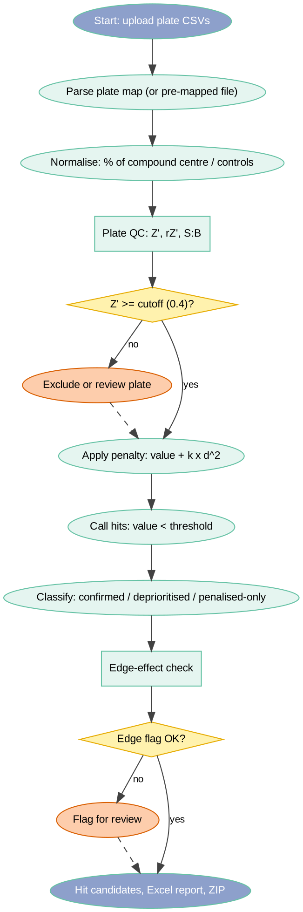

### 3D diagrams
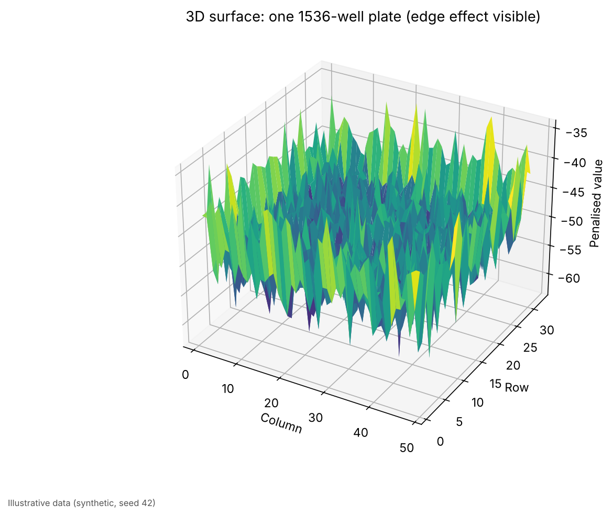
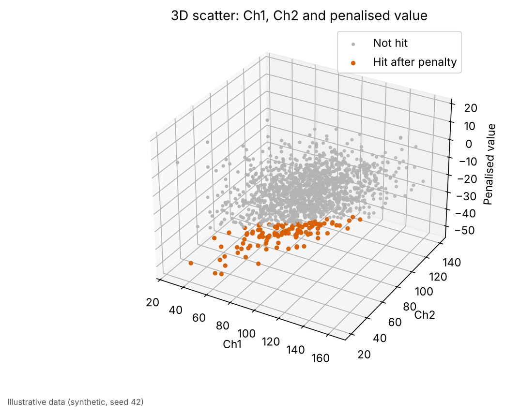

### 2D graph
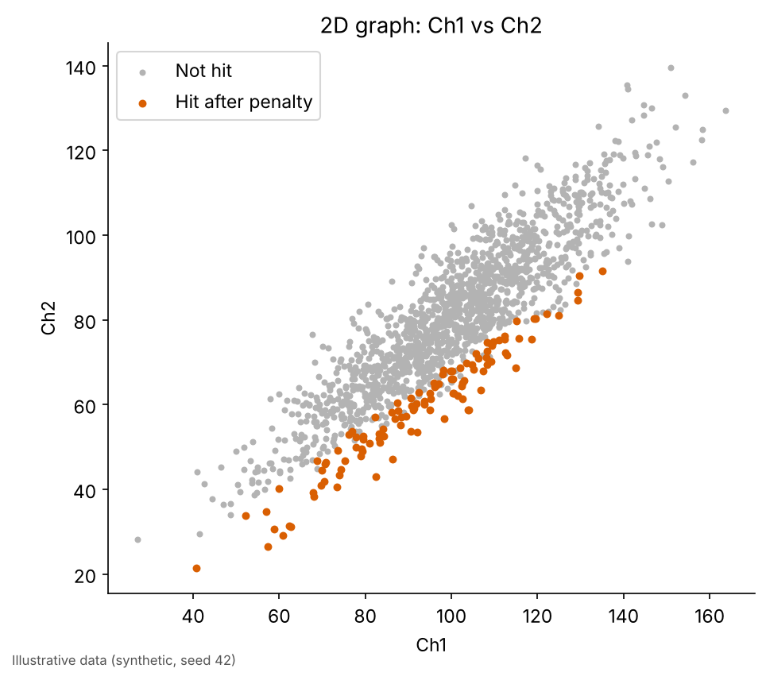

### Line graph
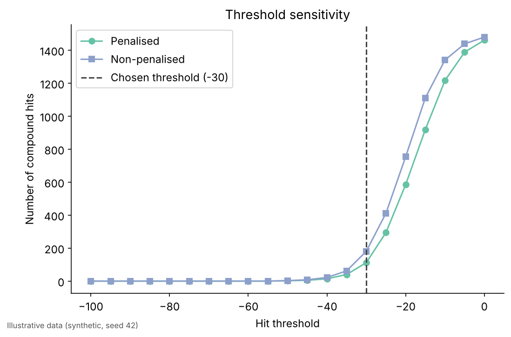

### Bar charts
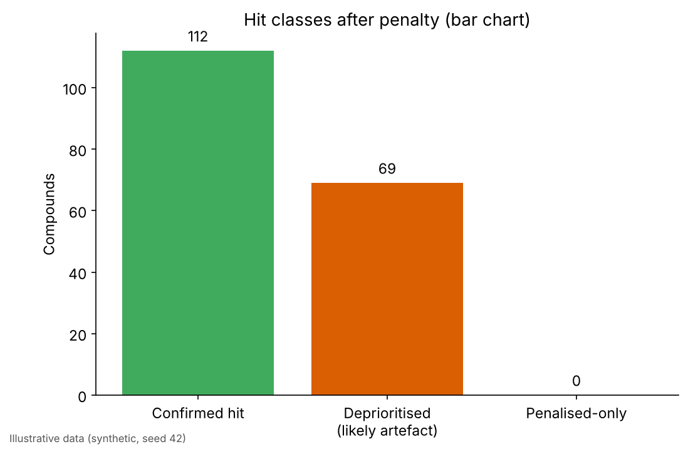
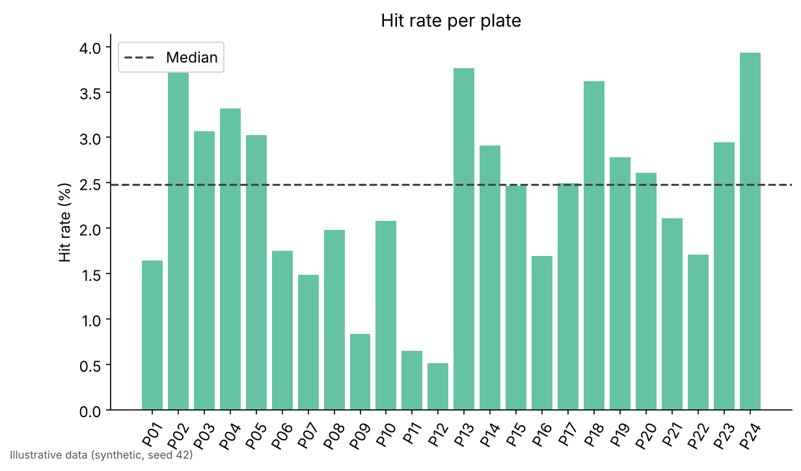

### Simulation
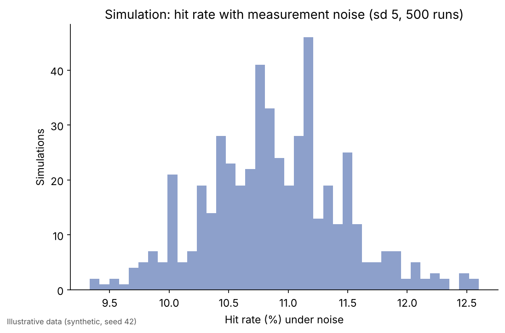

### CFD-style flow (teaching example, not a CFD solver)
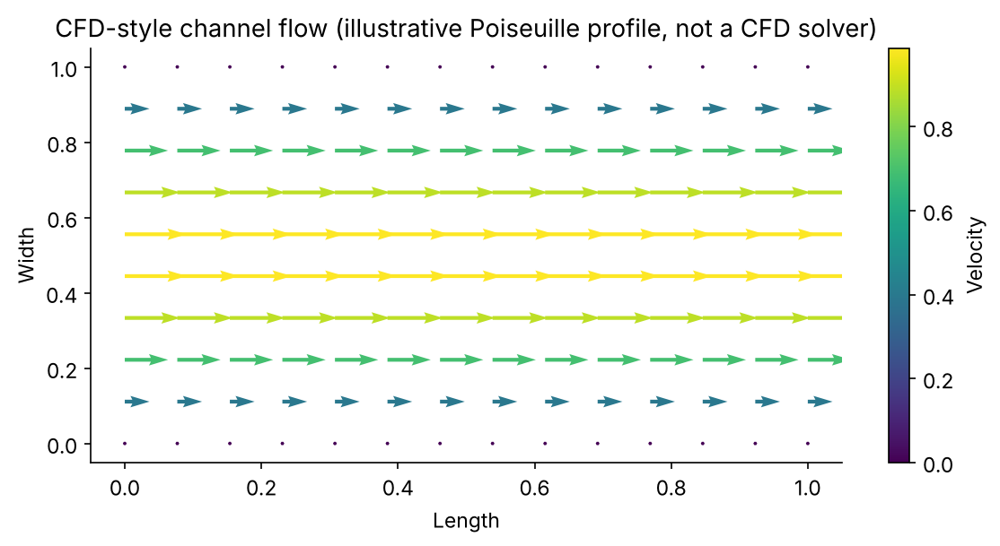

### Comparison table

| Measure | Value | Note |
|---|---|---|
| Compounds tested | 1,500 | Synthetic screen |
| Hits without penalty | see figure | Classical threshold on ratio |
| Hits after penalty | see figure | Threshold on penalised value |
| Deprioritised by penalty | see figure | Removed as likely artefacts |
| Penalty strength k | 2.0 | Set in sidebar |

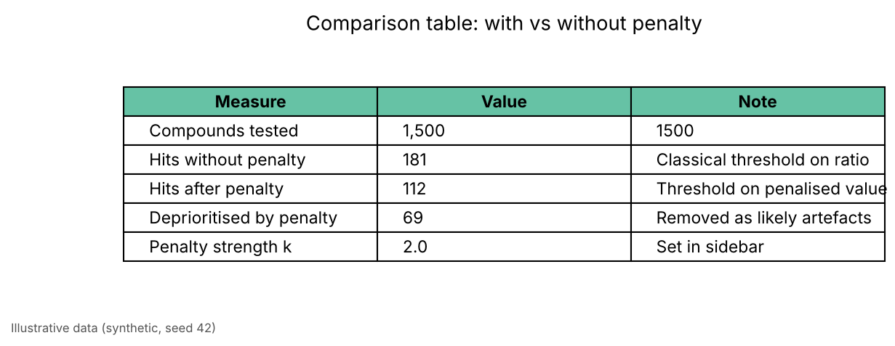

## User guide

[Read the user guide](HitPriorityGuide.docx)

## Tests

```r
testthat::test_dir(".", filter = "^test-")
```

## Changelog

See [CHANGELOG.md](CHANGELOG.md).

## Licence and authors

See [LICENSE.md](LICENSE.md) and [AUTHORS.md](AUTHORS.md).
